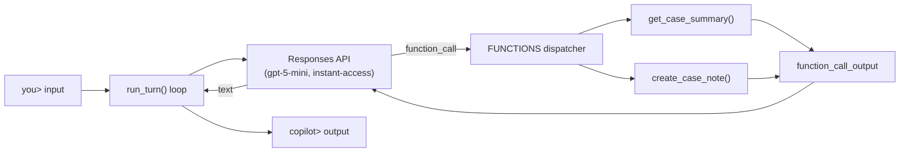

# crm-copilot-cli

CLI copilot on Azure OpenAI with function calling — the foundation of a CRM assistant with RAG and an eval harness.

> Exploring production AI patterns: tool calling → RAG → eval harnesses.

## What it does

A terminal REPL where you talk to a support copilot. It keeps conversation history
across turns and calls typed Python tools:

| Tool | What it does |
|---|---|
| `get_case_summary(case_id)` | Look up a support case (status, summary, notes) |
| `create_case_note(case_id, note)` | Attach a note to a case |

The case store is in-memory for now — TODO: swap for a real RAG lookup.

## Architecture



The model never executes code — it *requests* function calls, the dispatcher runs
the real Python, and results go back in. Adding tool #3 is one entry in each of
`TOOLS` (the JSON Schema contract the model sees) and `FUNCTIONS` (the dispatcher).

## Setup

```bash
pip install openai
export AZURE_OPENAI_API_KEY="your-key"
export AZURE_OPENAI_BASE_URL="https://<your-resource>.openai.azure.com/openai/v1/"
python crm_copilot.py
```

Keys and endpoint come from the Azure portal (Keys and Endpoint) or the Foundry
portal's project settings. **Config lives in env vars, never in code** — nothing
secret is committed to this repo.

## Try it

```
you> summarize case 1042
  [tool] get_case_summary({"case_id": "1042"})
copilot> Case 1042 is open: billing dispute, awaiting review. No notes yet.

you> add a note saying called the member back
  [tool] create_case_note({"case_id": "1042", "note": "Called the member back"})
copilot> Done — note added to case 1042.
```

Note the second turn: history chaining (`previous_response_id`) means you don't
repeat the case ID.

## Roadmap

- [ ] Replace in-memory store with RAG over case documents
- [ ] Eval harness — frozen test set, acceptance criteria per turn
- [ ] Guardrail layer (PII redaction), observability/tracing per turn
